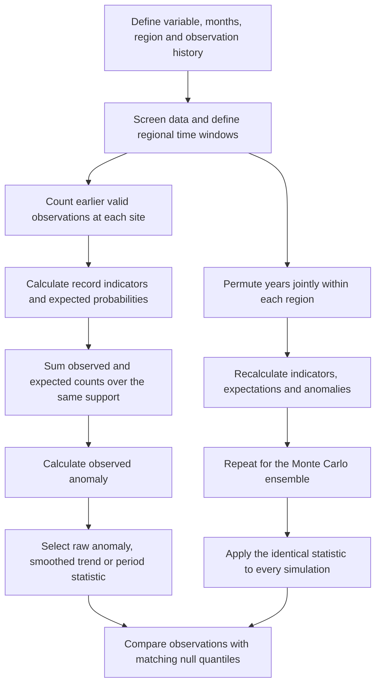

# Record-breaking anomaly: methodology and calculation guide

This guide explains the method in **Lehmann, Coumou and Frieler (2015), “Increased record-breaking precipitation events under global warming”**, together with its Supplementary Information. It develops the calculation from individual observations to regional anomalies and uncertainty estimates, then relates it to this repository's `RBanomaly` package.

**Primary sources:** [main paper (local PDF)][paper] and [Supplementary Information (local Word document)][si]. Page numbers below are the journal's printed pages, not PDF page indices. The core method is in Section 2.2, pp. 503–505; **Figure S6** illustrates the calculation and shuffling; **Figure 2, p. 506**, specifies what the plotted uncertainty bands represent.

The equations below use expanded notation for clarity. Worked examples, derivations, statistical cautions, and implementation recommendations are explanatory additions, not numerical results copied from the paper. The package comparison describes the source consolidated on 31 October 2026; it is not a claim of exact reproduction of the published analysis.

## 1. What the metric measures

A record-breaking observation exceeds every earlier valid observation in its own series. Record-breaking anomaly measures the **relative excess or deficit in the number of such records**, compared with the expectation under an independent and identically distributed (iid) reference process:

$$
A = R_{\mathrm{anom}}
  = 100\frac{O-E}{E},
$$

where $O=R_{\mathrm{obs}}$ is the observed record count and $E=R_{1/n}$ is its expected count over exactly the same eligible observations. This is the paper's Equation (1). [Paper, Section 2.2, pp. 503–504.]

- $A=0\%$: observed and expected counts agree.
- $A=+50\%$: 1.5 times as many records as expected.
- $A=-50\%$: half as many records as expected.
- $A=-100\%$: no observed records despite a positive expectation.
- $E=0$: the anomaly is undefined and should be reported as missing.

It measures record **frequency**, not the magnitude by which a record was exceeded. A 1 mm exceedance and a 100 mm exceedance each contribute one record. It does not estimate a return level, a fixed-threshold exceedance probability, or a change in the mean of the original variable. A large positive anomaly is also not, by itself, evidence of statistical significance or attribution to a particular forcing.

## 2. Workflow at a glance



The two essential consistency rules are: **use the same observations in the numerator and denominator**, and **compare the same statistic in observations and simulations**.

## 3. Assumptions and scope

### 3.1 The reference process is iid within each comparable series

Under the reference hypothesis, successive observations for a particular site and calendar month are independent draws from an unchanged distribution. “Identically distributed” applies through time within that series; different sites or months can have different distributions. The method does not require a common rainfall distribution across an entire region.

Stationarity alone does not imply independence. Serially correlated stationary data need not follow the exact iid record law. The paper supports its approximation by detrending the monthly Rx1day series with SSA, examining serial correlations of the residuals, and testing alternative block lengths. This is evidence for its precipitation application, not automatic validation for discharge, temperature, or another dataset. [Paper, pp. 504–505; SI, S1 and Figs. S11–S13.]

### 3.2 The simple record law assumes effectively continuous observations

For iid continuous observations, ties have probability zero. Rounded observations, repeated zeros, censoring, or instrument limits can produce ties; then strict records generally occur less often than the continuous $1/n$ expectation.

The paper defines a record using a strict exceedance. Follow that definition, document measurement precision, and inspect ties. Shuffling tied values preserves their discreteness, so the resulting null anomalies need not be centered exactly at zero relative to the continuous analytical denominator. Random tie-breaking would change the statistic and should not be introduced silently. This is a mathematical qualification of the reference model.

### 3.3 Missingness and measurement changes must be considered

Counting only available observations corrects their effective record history. It does not recover unobserved historical extremes or correct missingness that depends on event size. For example, a gauge failure during a flood can remove the very observation of interest.

Changing instruments, station relocation, changing rating curves, or changes in catchment management can alter observed records. These possibilities matter particularly when transferring the method from precipitation to discharge. They must be assessed separately from the formula.

### 3.4 Spatial independence is not required for the expected count

Expected counts can be added across correlated sites because expectation is linear. However, spatial dependence affects their **variance**: several nearby sites may break records during the same event. Treating those sites as independent can underestimate uncertainty. The paper therefore uses synchronized shuffling within regions. [Paper, Section 2.2.]

### 3.5 Record history and coverage define the question

A record is relative to the history included in the calculation. Changing the start year changes both the running maximum and the expected probability. A record relative to 1981–2010 is not necessarily a record relative to 1901–2010.

Similarly, a global aggregate of available sites represents those sampled sites. Normalization addresses the number and length of available series under the null; it does not make an uneven observing network geographically representative. The paper explicitly notes the strong contribution of the northern extratropics to its global sample. [Paper, Section 2.1, p. 502.]

## 4. Step-by-step calculation

### Step 1 — Define the observation unit and comparison groups

The paper starts with **monthly maximum one-day precipitation, Rx1day**. At a given grid cell, January values are compared with earlier Januaries, February values with earlier Februaries, and so on. It does not concatenate all months into one record sequence, nor does it first reduce the 12 monthly maxima to one annual maximum.

After identifying month-specific records, counts can be combined over:

- all 12 months for an annual result;
- November–March (NDJFM) for boreal winter;
- May–September (MJJAS) for boreal summer;
- the grid cells belonging to a specified region.

The main dataset was HadEX2, covering 1901–2010 on a $3.75^\circ\times2.5^\circ$ grid. The authors required at least **30 years of data per series** and at least **100 non-missing values at each time slice** for the retained region/time analysis, and selected the longest period satisfying their requirements. These are study-specific coverage criteria, not constants in the record formula. SI Fig. S8 further describes their application to monthly series contributing to annual analyses. [Paper, Section 2.1, pp. 502–503; SI, Figs. S6 and S8–S10.]

For reproduction, distinguish the history used to establish records, the regional window in which years are shuffled, and the period retained for reporting. Figure S6 shows these need not be the same boundaries. Also document how a cross-year season is labeled and aligned. The supplied text names NDJFM but does not fully specify every array-indexing convention needed to reproduce its winter-year alignment.

**Discharge adaptation:** a gauge's annual maximum discharge series can be one record sequence, with gauges as rows and years as columns. This uses the same record mathematics but a different event definition from the paper's month-specific precipitation analysis.

### Step 2 — Organize data and count valid history

Write the data for month $m$ as a matrix $X^{(m)}$ with sites in rows and chronological years in columns. Define:

| Symbol | Meaning |
| --- | --- |
| $i$ | Site or grid cell |
| $m$ | Calendar month or comparable series type |
| $t$ | Chronological year position |
| $x_{imt}$ | Observed value, possibly missing |
| $v_{imt}$ | 1 if the observation is valid; otherwise 0 |
| $n_{imt}=\sum_{u\leq t}v_{imu}$ | Number of valid observations through the current year |
| $h_{imt}=\max_{u<t:v_{imu}=1}x_{imu}$ | Largest earlier valid observation |
| $q_{imt}$ | Eligibility: current value is valid and $n_{imt}\geq2$ |

A missing year does not increase $n_{imt}$. A newly established station starts at observation number 1, even if it joins late in the regional calendar.

### Step 3 — Identify observed records

For an eligible observation, define the record indicator:

$$
b_{imt}=\mathbf{1}\{x_{imt}>h_{imt}\}.
$$

Thus $b=1$ for a new strict record and $b=0$ otherwise. Missing observations and first valid observations are excluded rather than classified as ordinary non-records.

The very first observation is formally a record with expected probability 1. Including it would force a zero anomaly at initialization. The paper therefore excludes the first observation from both observed and expected counts. SI Fig. S6 also shows this exclusion for series beginning later than other sites. [Paper, p. 504; SI, Fig. S6.]

**Implementation order matters:** compare the current value with the previous maximum first, then update the maximum and valid-observation count. Updating the maximum before comparison would prevent strict record detection.

### Step 4 — Calculate the iid expectation

Among $n$ iid continuous observations, every position is equally likely to contain the unique maximum. Therefore:

$$
\Pr(\text{the }n\text{th valid observation is a record})=\frac1n.
$$

For each eligible observation:

$$
e_{imt}=\frac{1}{n_{imt}}.
$$

Two related quantities must be distinguished:

$$
\underbrace{\Pr(\text{record at position }n)}_{\text{one observation}}
=\frac1n,
\qquad
\underbrace{\mathbb{E}[\text{records through position }N]}_{\text{cumulative count}}
=H_N=\sum_{n=1}^{N}\frac1n.
$$

With the first observation excluded, the cumulative expectation becomes $H_N-1$. The harmonic sum is not the expected count for one year. At a particular year, sum the eligible sites' current $1/n_{imt}$ values instead.

This distribution-free result does not require fitting a GEV, Gaussian, or other parametric distribution. A fixed strictly increasing transformation of a series preserves its records; a time-varying transformation need not do so. [Record-law explanation of Paper, Section 2.2.]

### Step 5 — Aggregate observed and expected counts over identical support

Let $\mathcal S$ be the selected sites, months, and reporting years for which observations are eligible. Compute:

$$
O_{\mathcal S}=\sum_{(i,m,t)\in\mathcal S}b_{imt},
\qquad
E_{\mathcal S}=\sum_{(i,m,t)\in\mathcal S}\frac1{n_{imt}},
$$

then:

$$
A_{\mathcal S}=100\left(\frac{O_{\mathcal S}}{E_{\mathcal S}}-1\right).
$$

For an annual anomaly series, restrict $\mathcal S$ to one year at a time and sum over its selected sites and months. For a seasonal result, retain the designated months. Each month keeps its own history even when its record counts are pooled with other months. [Paper, Equation (1) and its definitions, pp. 503–504.]

**Pool counts before normalization.** An unweighted average of site/month anomalies generally gives a different result. For component groups $g$ with positive expected counts:

$$
A_{\mathrm{pooled}}
=\frac{\sum_g E_g A_g}{\sum_g E_g}.
$$

The pooled anomaly is an expected-count-weighted average of component anomalies. The paper describes sums of records; this does not imply equal weighting of regional percentages or explicit area weighting. Adding catchment-area or grid-area weights is an extension that changes the estimand and must be applied consistently to observed counts, expected counts, and simulations.

### Step 6 — Distinguish a reporting period from the record history

To ask about records during a recent period, establish records using the chosen historical baseline, then select the relevant years' record indicators and expectations. Truncating the original data to the reporting period before record detection resets the history and answers a different question.

Also distinguish these two temporal summaries:

$$
A_{\mathrm{period}}=100\frac{\sum_{t\in T}O_t-\sum_{t\in T}E_t}
{\sum_{t\in T}E_t},
\qquad
\overline A_T=\frac1{|T|}\sum_{t\in T}A_t.
$$

The first is a pooled-count period anomaly; the second gives every retained year equal weight. They coincide only under particular conditions, such as constant $E_t$. Equation (1) provides the pooled-count construction, while Section 4 describes its regional results as time-averaged anomalies without a separate explicit temporal averaging equation. For exact numerical reproduction of those maps, verify that implementation choice rather than silently treating the two summaries as interchangeable. Whichever statistic is chosen must also be used in the simulations.

## 5. Worked illustration: two sites and six years

This artificial example demonstrates a late start, a missing year, and ties. It is too small for substantive inference.

### 5.1 Input and site-level calculations

| Quantity | Year 1 | Year 2 | Year 3 | Year 4 | Year 5 | Year 6 |
| --- | ---: | ---: | ---: | ---: | ---: | ---: |
| Site A observation | 10 | 12 | 12 | NA | 15 | 14 |
| Site A valid count $n$ | 1 | 2 | 3 | 3 | 4 | 5 |
| Site A record indicator | excluded | 1 | 0 | missing | 1 | 0 |
| Site A expected contribution | excluded | 1/2 | 1/3 | missing | 1/4 | 1/5 |
| Site B observation | NA | 8 | 9 | 9 | NA | 11 |
| Site B valid count $n$ | 0 | 1 | 2 | 3 | 3 | 4 |
| Site B record indicator | missing | excluded | 1 | 0 | missing | 1 |
| Site B expected contribution | missing | excluded | 1/2 | 1/3 | missing | 1/4 |

Site A's 12 in Year 3 ties its previous maximum and is not a record. Site B's 8 in Year 2 is its first valid observation, so it is excluded. Site A's probability in Year 5 is $1/4$, not $1/5$, because Year 4 was missing.

### 5.2 Regional calculation

| Year | Observed count $O_t$ | Expected count $E_t$ | Anomaly $A_t$ |
| --- | ---: | ---: | ---: |
| 1 | 0 | 0 | undefined |
| 2 | 1 | 1/2 | +100% |
| 3 | 1 | 1/3 + 1/2 = 5/6 | +20% |
| 4 | 0 | 1/3 | −100% |
| 5 | 1 | 1/4 | +300% |
| 6 | 1 | 1/5 + 1/4 = 9/20 | +122.22% |

For example, Year 3 gives:

$$
A_3=100\frac{1-5/6}{5/6}=20\%.
$$

Over Years 2–6, $O=4$ and $E=71/30$, so the pooled-count anomaly is:

$$
A_{2:6}=100\frac{4-71/30}{71/30}
=100\frac{49}{71}\approx69.01\%.
$$

The arithmetic mean of the five annual anomalies is approximately **88.44%**, demonstrating why pooling and averaging are different. The +300% annual anomaly is produced by only one observed event and a small expectation; its size alone says little about significance.

## 6. Constructing the null ensemble and uncertainty

### 6.1 What uncertainty is being estimated?

The simulations ask: **what anomalies could arise if the observed values had no preferred temporal order, under the selected dependence and coverage treatment?** They generate a reference distribution under a null model, not measurement-error bounds and not automatically a confidence interval for a climate-change effect.

The paper calls the resulting ranges confidence intervals. For interpretation, “null-model reference bands” makes their role explicit. Their width reflects record sampling variability and the dependence retained by the shuffling design. Measurement errors, unobserved extremes, and structural uncertainty about the null model are not automatically included.

### 6.2 One simulation, step by step

Following Section 2.2 and SI Fig. S6:

1. **Define regional time boundaries.** Identify the window within which a region supplies data. Do not indiscriminately shuffle its observations across the entire global calendar.
2. **Draw a permutation of year columns without replacement.** This is temporal shuffling, not sampling observations with replacement.
3. **Use that same permutation for all sites within the region.** Contemporaneous spatial configurations are retained.
4. **Use the same permutation for the selected monthly series.** Jointly aligned monthly values remain associated within the permuted year/season units. Keep the adopted cross-year seasonal alignment explicit.
5. **Move missing entries with their columns.** The main synchronous procedure does not freeze every site's original missing-year positions.
6. **Recompute record histories from scratch.** Determine new first valid observations, running maxima, record indicators, and current valid counts in the shuffled order.
7. **Recompute the expected denominator for that realization.** Missing values can change the valid-history counts at individual sequence positions. Do not automatically reuse the observed year-specific denominator.
8. **Aggregate and normalize as for observations.** Keep each simulated anomaly at its shuffled sequence position. Do not sort it back by the original calendar labels of the sampled values.
9. **For a global analysis, combine regional results on the reporting calendar.** The paper partitions the data into 21 regions, performs regional shuffling, and combines the results. Preserve the declared count-aggregation/statistic convention.
10. **Repeat 10,000 times**, as in the paper, and retain the statistic of interest from every realization.

For one region and month:

$$
X^{*(b,m)}_{i,j}=X^{(m)}_{i,\pi_b(j)},
$$

where $b$ indexes simulations and the permutation $\pi_b$ is shared by that region's sites and selected months. Different regional windows require a regional procedure; a single global permutation cannot in general reproduce it.

Random permutation removes systematic temporal ordering while retaining the empirical values. Strictly, a finite permutation sample is a conditional randomization construction, not fresh independent sampling with replacement from a distribution. Its validity relies on the chosen exchangeability/dependence approximation.

### 6.3 The missing-data versus spatial-dependence compromise

The paper highlights a limitation of its resampling alternatives. Independently shuffling each site's available values while holding missing positions fixed preserves exact local coverage histories, but loses spatial synchronization. Shuffling whole regional columns preserves synchronization, but redistributes missingness within the regional window.

The adopted compromise preserves spatial dependence **within regions** and major differences in observation windows **between regions**. It does not preserve every missing entry's date, nor guarantee preservation of dependence between separate regions. SI Figs. S8–S10 show how the regional approach approximately retains the large-scale growth in global coverage. [Paper, pp. 504–505.]

SI Fig. S7 shows that the alternative with frozen missing positions and lost spatial correlation produces generally narrower bands in this study. The authors therefore regard their chosen bands as conservative relative to that sensitivity test. This is an empirical comparison for their data, not a universal guarantee that synchronized shuffling is conservative for every application.

### 6.4 Match the uncertainty band to the statistic

Let $A_t^{*(b)}$ denote the raw anomaly from realization $b$, and let $S$ denote the chosen smoothing procedure.

| Question | Observed statistic | Statistic calculated in each simulation |
| --- | --- | --- |
| Is this individual year's anomaly unusual? | $A_t$ | $A_t^{*(b)}$ |
| Is the smooth long-term component unusual? | $S(A)_t$ | $S(A^{*(b)})_t$ |
| Is a pooled period count unusual? | $A_{\mathrm{period}}$ | The same pooled-count period formula |
| Is the mean annual anomaly unusual? | $\overline A_T$ | The same mean over the same retained years |

For a statistic $Z_t$ and $B$ realizations, the central intervals are:

$$
I_{90}(t)=[Q_{0.05}\{Z_t^{*(b)}\},Q_{0.95}\{Z_t^{*(b)}\}],
$$

$$
I_{95}(t)=[Q_{0.025}\{Z_t^{*(b)}\},Q_{0.975}\{Z_t^{*(b)}\}].
$$

The 95% interval contains the 90% interval. They need not be symmetric about zero. “95% interval” means a central range, not merely the 95th percentile.

**Figure 2's bands are calculated from the simulated SSA trends.** Its black observed SSA line can be compared directly with those bands. The gray annual bars are a different statistic and should not be judged against the smoothed-trend bands as if they were raw-anomaly intervals. Figure 3 uses the same distinction. [Paper, Fig. 2 caption, p. 506; Fig. 3 caption, p. 508.]

For a period statistic, calculate one period statistic per realization and then take ensemble quantiles. Averaging annual lower and upper bounds does not generally produce an interval for the period average.

### 6.5 Significance, multiple comparisons, and Monte Carlo precision

The paper's criterion is that the observed statistic lies outside its null model's central 95% range. Values above the upper bound indicate unusually frequent records; values below the lower bound indicate unusually few records, conditional on the model.

Three interpretation details are essential:

- These are pointwise comparisons unless an additional simultaneous procedure is defined. Examining many years, seasons, or regions does not give a 5% error rate for the entire collection of comparisons.
- A smooth curve outside a band is not automatically a test that its slope is nonzero. It indicates departure from the null distribution of that smooth statistic at those positions.
- A result inside a band means the analysis does not reject that null at the chosen level; it does not prove the climate is unchanged.

The simulation count controls numerical precision, not the scientific adequacy of the null model. With 10,000 independent realizations, a 2.5% tail contains roughly 250 simulations; with 1,000, only about 25. As a numerical illustration, the Monte Carlo standard error of an estimated tail probability near 0.025 is approximately $\sqrt{0.025(1-0.025)/B}$, or 0.0016 at $B=10{,}000$. This is uncertainty in the probability estimate, not the uncertainty in an anomaly quantile's units.

Record the random seed and quantile convention, increase the simulation count for final estimates, and check whether conclusions near a threshold remain stable across seeds. Do not report a simulated tail probability as exactly zero simply because no realization exceeded the observation.

## 7. Long-term trends and SSA

The paper uses singular spectrum analysis with a **15-year window** to extract nonlinear trends, describing the result as similar to a 30-year moving average. These are not identical filters. [Paper, p. 505.]

Conceptually, SSA:

1. forms a trajectory matrix from overlapping length-$L$ segments of the anomaly series;
2. decomposes that matrix into components using a singular-value/eigenvalue decomposition;
3. selects components representing the intended slowly varying signal;
4. reconstructs a time series by averaging the corresponding matrix anti-diagonals.

Apply the identical window, component selection, edge treatment, and missing-value policy to observed and simulated anomalies. Smooth **each simulation before taking quantiles**. Smoothing raw-anomaly quantiles afterward is not generally equivalent.

The supplied paper specifies $L=15$ but does not provide a complete eigentriple-selection recipe or every boundary/missing-value implementation detail. Therefore, `groups = list(trend = 1)` is a package choice, not a documented author setting established by these files. The package currently removes missing edges before fitting, restores them afterward, and rejects interior gaps; that policy should likewise not be attributed to the paper.

SSA appears in two different parts of the study: detrending original monthly precipitation for diagnostics/model construction, and smoothing the derived anomaly series for long-term comparison. Do not detrend away the observed change before calculating the main observed record anomaly.

## 8. Assumption checks and sensitivity analysis

The paper's supporting checks are useful models for a new application, but their outcomes should not be assumed to transfer.

| Issue | Evidence or treatment in the paper | What to check in a new dataset |
| --- | --- | --- |
| Temporal dependence | SSA-detrended monthly residual correlations were mostly between −0.2 and +0.2; mean variance inflation factor about 1.1 | Residual autocorrelation across relevant lags and persistence of extremes |
| Block length | Two- and three-year block-shuffling sensitivity tests gave similar bands | Whether one-year permutations destroy dependence important to the statistic |
| Coverage versus dependence | Compared synchronous regional shuffling with frozen-missingness alternatives | Site windows, overlap, spatial correlation, and simulated coverage trajectories |
| Dataset robustness | Compared HadEX2 and GHCNDEX over their common 1951–2010 period | Sensitivity to data source, processing, and common-history choices |
| Sparse sampling | Minimum record lengths and regional counts; some seasonal regions omitted | Number of eligible comparisons and expected records in every reported year |

Sources: Paper, Sections 2.1–2.2; SI, S1 and Figs. S5, S7–S13.

Small autocorrelations do not prove independence or constant variance. Further useful checks include record-start sensitivity, changes in missingness associated with extremes, tied-value prevalence, alternative region boundaries, and SSA component/window sensitivity. If substantial dependence remains, define an appropriate alternative null model and recalibrate the simulations; merely increasing the number of shuffles does not solve model misspecification.

## 9. Interpreting the result without overclaiming

**An anomaly is not an intensity increase.** A +50% record anomaly does not imply 50% more precipitation or a 50% increase in flood peaks. Record indicators discard the size of each exceedance.

**A zero-centered null is a reference, not a guarantee for every simulation.** Individual realizations fluctuate; coverage, ties, and the selected statistic can complicate the ideal analytical centering.

**Normalization is not a complete correction for network changes.** Under the iid model, additional eligible sites increase both the observed expectation and its denominator. Outside that model, changes in which climates or catchments are sampled can change the aggregate even after normalization.

**Detection and attribution are different.** A significant departure can be compatible with distributional change, but the metric alone does not identify whether the cause is greenhouse forcing, internal variability, changing land use, river regulation, or observation artifacts. The paper uses additional comparisons with a temperature-based model and ENSO to investigate explanations.

For an aggregate with $A>0$, the descriptive fraction of observed records in excess of the reference count is:

$$
f_{\mathrm{excess}}=\frac{O-E}{O}=\frac{A}{100+A}.
$$

For example, +12% excess relative to expectation corresponds to approximately 10.7% of the observed count. This algebraic conversion is not automatically the causal probability that a particular event was caused by climate change. It also requires consistent aggregation: converting an average of annual percentages does not necessarily yield the fraction of all observed events.

## 10. The paper's additional temperature-based model

The statistical Clausius–Clapeyron model in Section 2.3 is a **second comparison model**, not part of the definition of record-breaking anomaly. It asks whether temperature-related changes in atmospheric moisture capacity can explain the observed record evolution. [Paper, pp. 505–506, Equations (2)–(5).]

Its construction combines a thermally determined nonlinear precipitation component with variability based on detrended monthly precipitation observations. For each site/month, it uses a smoothed temperature history and the saturation-vapor-pressure approximation:

$$
e_s(T)=6.1094\exp\left(\frac{17.625T}{T+243.04}\right).
$$

In this coefficient convention, $T$ is in degrees Celsius and $e_s$ is in hPa; the vapor-pressure ratios below are dimensionless.

The temperature-driven relative change is based on $[e_s(T_{\mathrm{trend}})-e_s(\overline T)]/e_s(\overline T)$, and the precipitation climatological mean converts that relative change into precipitation units. A unit-consistent explanatory notation is:

$$
\delta_t=\frac{e_s(T_{\mathrm{trend},t})-e_s(\overline T)}{e_s(\overline T)},
\qquad
\Delta p_{\mathrm{thermal},t}=\overline p\,\delta_t.
$$

Here $\delta_t$ is a fraction. If expressed as a percentage, divide it by 100 before multiplying by $\overline p$. The paper writes its relative change in percent; this explicit distinction avoids a factor-of-100 implementation error. Adding a fixed baseline to a given synthetic series does not change its record ordering.

The resulting model ensembles are evaluated with the same record-anomaly normalization and analogous shuffling-based uncertainty. This comparison tests consistency with a proposed physical scaling, rather than inferring a unique mechanism from record counts alone. The current package does not implement this temperature-based model or the paper's ENSO analysis.

## 11. Relationship to the current R package

This mapping is based on [RB_anomaly.R](../R/RB_anomaly.R), [trend_utils.R](../R/trend_utils.R), and [SSA_trend.R](../R/SSA_trend.R).

| Function | Statistic or role | Important interpretation |
| --- | --- | --- |
| `rb_anomaly_ci()` | Unified raw/SSA/LOESS null bands | Explicit statistic, settings, and matched observed/simulated processing |
| `Func_Ranom()` | Record indicators for one series | Strict exceedance; first valid observation excluded |
| `Func_Ranom_1N()` | Expected probabilities for one series | Uses the number of valid observations |
| `Func_RB_matrix()` | Site-by-year record and expectation matrices | Foundation for count aggregation |
| `Func_RB_region()` | Regional annual anomaly | Returns `year`, `R1n`, `Robs`, `Ranom`, `n_eligible`; retains full precision |
| `Func_RB_region_list()` | Combines aligned datasets/months | Pools counts; combined result is `out_Ranom` |
| `Func_RB_region_list_CI_fast()` | SSA trend and null SSA-trend bands | Closest existing function to the Figure 2 comparison for one regional window |
| `Func_RB_region_list_CI()` | Raw-anomaly bands with an observed LOESS trend | Bands describe raw anomalies, not that LOESS trend |
| `RB_Ranom_CI()` | Raw-anomaly bands for one input matrix | Also returns observed LOESS; same statistic distinction applies |
| `LOESS_Trend_CI()` | LOESS trend and LOESS-trend bands | A smoothing alternative; returns a 90% interval, not the paper's SSA method |
| `RB_Ranom_CI_index()` | Deprecated calendar-reindexed shuffled anomalies | Reorders results by sampled original years; differs from the sequence-position null in SI Fig. S6 |
| `ssa_trend()` / `ssa_trend_matrix()` | SSA reconstruction | Window and selected eigentriples must be recorded |

Important implementation boundaries:

- The fast function's `loess_trend` column actually contains an **SSA** trend. Its name is retained for compatibility.
- The fast function defaults to 1,000 runs; the paper used 10,000. Set `runs` explicitly for the intended analysis.
- A list passed to the fast function receives one shared permutation across all elements. It is appropriate for aligned months or variables within one region. It is **not** an implementation of 21 independently windowed geographic regions simply because the input is a list.
- The package does not automatically impose the paper's coverage thresholds, determine regional shuffling windows, align cross-year seasons, or run its iid diagnostics and block-length sensitivity checks.
- The fast SSA workflow rejects interior missing anomalies. The paper does not establish that exact missing-value policy. All-missing years therefore need an explicit analysis decision.
- The raw matrix expectation accommodates missing observations, but does not correct tied-value effects in the $1/n$ model.
- All calculation paths retain full precision. Years without eligible observations have zero summed counts, `n_eligible = 0`, and `NA` anomaly. For pooled statistics, sum `Robs` and `R1n` before normalization.
- `rb_anomaly_ci()` returns `data` and `settings`; `data$statistic_value` is the selected statistic. The old CI functions are wrappers preserving their historical targets and output columns; the calendar-reindexed function retains its distinct calculation with a deprecation warning.

These distinctions matter when describing an analysis as “based on Lehmann et al.” versus an exact reproduction of the paper.

## 12. Reproducible examples

### 12.1 Verify the worked calculation

After installing the package, this example reproduces the table in Section 5:

```r
library(RBanomaly)

x <- rbind(
  A = c(10, 12, 12, NA, 15, 14),
  B = c(NA, 8, 9, 9, NA, 11)
)
year <- 2001:2006

site_records <- Func_RB_matrix(x)
annual <- Func_RB_region(x, year)
annual

expected <- c(0, 1/2, 5/6, 1/3, 1/4, 9/20)
observed <- c(0, 1, 1, 0, 1, 1)
stopifnot(isTRUE(all.equal(annual$R1n, expected)))
stopifnot(isTRUE(all.equal(annual$Robs, observed)))

pooled <- 100 * (sum(annual$Robs) - sum(annual$R1n)) /
  sum(annual$R1n)
pooled # 69.01408

# Compute the mean from unrounded annual anomalies for this comparison.
valid <- annual$R1n > 0
mean_annual <- mean(100 * (annual$Robs[valid] / annual$R1n[valid] - 1))
mean_annual # 88.44444
```

### 12.2 Demonstrate the SSA ensemble workflow

Use a longer artificial series for smoothing. This example represents one region with complete data; it does not reproduce the precipitation study or its spatial dependence structure.

```r
set.seed(42)
year <- 1961:2020
x <- matrix(rlnorm(20 * length(year)), nrow = 20)

fit <- Func_RB_region_list_CI_fast(
  list(x), year,
  seed = 123,
  runs = 200,                 # demonstration only; paper used 10000
  L = 15,
  groups = list(trend = 1)    # package choice; not fully specified by paper
)

plot_Ranom_CI(fit)

# Compare the observed SSA trend, not the raw annual bars, with these bands.
outside_95 <- with(fit,
  loess_trend < ci_lower_95 | loess_trend > ci_upper_95
)
data.frame(year, outside_95)
```

The first anomaly is undefined by construction. Do not interpret an `NA` comparison as non-significant. The small demonstration ensemble is for understanding the workflow; use a suitable larger ensemble and sensitivity checks for scientific conclusions.

## 13. What to report with an analysis

Record enough information to make the numerator, denominator, and null model reproducible:

1. Variable, units, temporal aggregation, data source, and event definition.
2. Sites/months/regions, seasonal-year alignment, record-history start, regional shuffling windows, and reporting period.
3. Coverage filters, missing-value rules, ties, and any site or area weighting.
4. Observed counts, expected counts, eligible observation counts, and anomalies.
5. Evidence supporting the reference model and treatment of temporal/spatial dependence.
6. Permutation design, number of simulations, seed, and quantile convention.
7. Target statistic: raw annual anomaly, SSA/LOESS trend, pooled period anomaly, or mean annual anomaly.
8. Smoothing window, component selection, missing-value and endpoint treatment.
9. Whether significance is pointwise or adjusted across multiple comparisons.
10. Sensitivity results and any departures from the published procedure.

## 14. Source navigation

| Source location | What it supports |
| --- | --- |
| Main paper, Section 2.1, pp. 502–503 | Rx1day, spatial/temporal coverage, months, data requirements, comparison dataset |
| Main paper, Section 2.2, pp. 503–505 | Record definition, Equation (1), missing history, first-observation exclusion, shuffling, 10,000 runs, regions, dependence and SSA |
| Main paper, Figure 2, p. 506 | Raw bars versus SSA trend; uncertainty bands computed from equally smoothed null realizations |
| Main paper, Section 2.3, pp. 505–506; Figure 3, p. 508 | Temperature-based comparison model and its trend uncertainty |
| Main paper, Section 4 and Figures 4–5, pp. 509–511 | Regional reporting-period comparisons |
| SI, S1 and Figure S13 | Detrending and serial-correlation diagnostics |
| SI, Figure S6 and its caption | Region-specific windows, matrix orientation, missing observations, expected counts, synchronized shuffling |
| SI, Figures S7–S10 | Missingness/spatial-dependence tradeoff and coverage effects |
| SI, Figures S11–S12 | Two- and three-year block sensitivity |
| SI, Table S1 | Geographic boundaries and the 21 regions used for global aggregation |

**Bibliographic reference:** Lehmann, J., Coumou, D., and Frieler, K. (2015). Increased record-breaking precipitation events under global warming. *Climatic Change*, **132**, 501–515. [doi:10.1007/s10584-015-1434-y](https://doi.org/10.1007/s10584-015-1434-y). The bibliographic identity was also checked against the [authors' institutional publication listing](https://www.pik-potsdam.de/members/frieler/publications); the methodological account above is based on the local paper and SI.

[paper]: <Increased record-breaking precipitation events under global warming.pdf>
[si]: <Appendix-Increased record-breaking precipitation events under global warming.docx>
